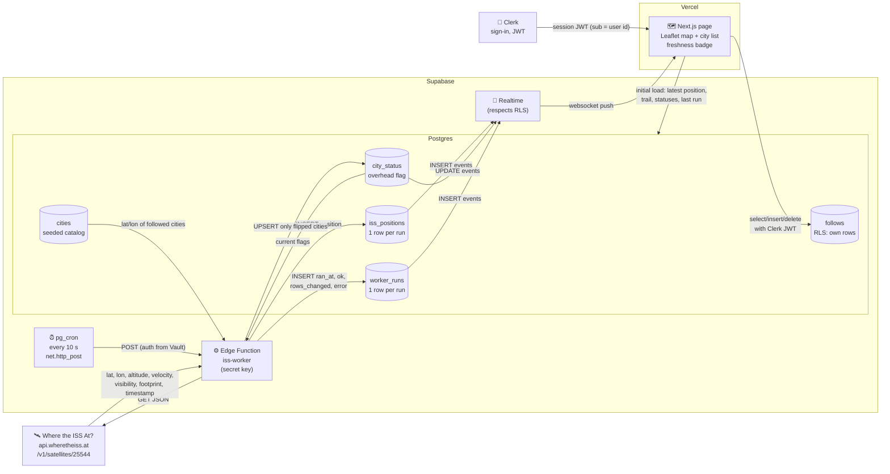

# Data flow: ISS Flyover

Drawn in Step 3, **before any worker or page code**. Decisions: poll every **10 s** (D4); **fresh** under 30 s, **stale** at 30 s or more (3 missed runs), **down** when the last run failed (D5); users follow **cities**, and the worker records **overhead flips** only.

## High-level chart

## What each arrow carries

| # | From → To | Carries | What breaks if it changes |
|---|---|---|---|
| 1 | pg_cron → worker | An HTTP POST every 10 s, with a key read from Vault | If the job stops, or the key is rotated without updating Vault, no new rows arrive and the page goes **stale** within 30 s. |
| 2 | worker ↔ ISS API | GET → JSON: `latitude`, `longitude`, `altitude`, `velocity`, `visibility`, `footprint`, `timestamp` | If the API is down, rate-limits us, or renames a field: the worker catches it, writes `worker_runs.ok = false` with the error, and the page shows **down**. A missing field must fail loudly, not write NaN. |
| 3 | worker → `iss_positions` | One new row per run | This is the only table that changes every run (the position really is new each time). If inserts fail, the map freezes, and freshness goes stale and then down. |
| 4 | `cities` + `city_status` → worker | The followed cities' lat/lon and their current overhead flag | The worker compares the new flag (`distance ≤ footprint / 2`) with the stored one. If the formula or units change (km vs. miles), flags flip wrongly. |
| 5 | worker → `city_status` | An **upsert of only the cities whose flag flipped** (a few per day per city) | This is the "save only what changed" rule. Rewriting every city every run would burn Realtime messages (city count × open pages × 8,640 a day). |
| 6 | worker → `worker_runs` | `ran_at`, `ok`, `rows_changed`, `error`, one row per run, success or failure | This is the page's heartbeat for **down**, and our audit log. If the worker crashes before writing it, the page falls back to **stale**, which goes by data age. |
| 7 | tables → Realtime → page | Postgres changes pushed over a websocket, filtered by RLS for the signed-in user | Each table needs all three of these: **in the `supabase_realtime` publication**, **`grant select`**, and an **RLS select policy**. If any one is missing, the page silently gets nothing. |
| 8 | Clerk → page → `follows` | A Clerk session JWT; Supabase reads `auth.jwt()->>'sub'` as `user_id` | RLS on `follows` allows only rows where `user_id = sub`. If the Clerk↔Supabase third-party auth breaks, the request is anonymous and gets no follows (permission denied). |

## Freshness states (on the page)

| State | Rule | Shown as |
|---|---|---|
| **Loading** | Before the first data arrives from the initial load | Map skeleton and "Locating the ISS…" |
| **Fresh** | Now − newest `iss_positions.fetched_at` < 30 s, and the last run was ok | Green dot, "Updated 4 s ago" (ticks every second) |
| **Stale** | Age ≥ 30 s (3 missed runs) | Amber, "Last update 2 min ago, the worker may be paused". Map is dimmed. |
| **Down** | Newest `worker_runs.ok = false` | Red, "Source unreachable since 12:04", plus the error summary. Map shows the last known position. |

The age is computed **in the browser** from timestamps. That way, if Realtime stops pushing, the badge still drifts to stale by itself.

## Who writes what

- **Worker (secret key, bypasses RLS):** `iss_positions`, `city_status`, `worker_runs`.
- **Signed-in user (Clerk JWT, RLS):** read `iss_positions`, `cities`, `city_status`, `worker_runs`; read, insert, and delete only their own `follows`.
- **Signed-out:** nothing (no grants to `anon`).
